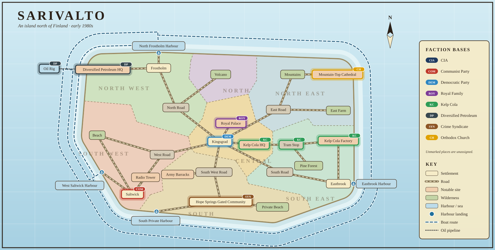

# Sarivalto

A 2D top-down, Pokémon-style game set in the early 1980s Cold War. The player is a CIA agent on a
fictional island north of Finland, where the king has just died and the island must not fall to the
Soviet Union. Seven factions compete for control.

**Current stage:** map prototype only. Walk around all 30 locations (plus building interiors); no characters, dialogue or
game mechanics yet. Layouts are placeholders.

## Run it

No build step. Open `index.html` in a browser, or serve the folder:

    python3 -m http.server 8000

Kingsgrad has a light steampunk look: its own buildings with smoking chimney stacks and copper pipework, verdigris copper roofs
and brass-bound doors on a few of them, under a sepia haze. Add `?classic` to the address (`index.html?classic`) to see the town as
it was before, or `?steam` for the full steampunk proof of concept: soot-dark brick, riveted iron and verdigris copper, with brass,
pipes, smoking stacks, turning gears and an airship overhead. Both start the game in Kingsgrad.

Every outdoor place has a day and a night version: switch with the Day/Night button beside "Jump to" (or the N key), or add
`?night` to the address (for example `index.html?night`) to start at night. Frostholm and its harbour have their own purple
neon night; everywhere else has a moonlit blue one, lit by windows, lamps, fires and signs. Interiors look the same at any time.

## Controls

Arrows / WASD to move. Face someone and press E (or Space, Enter, or the E button) to talk to them. Everyone keeps a routine: by day they are at work, and at night they are at home, beside a bed. Some places keep opening hours (`DAY_ONLY` and `NIGHT_ONLY` in `js/data.js`): their doors don't open while they're shut (and the day-only ones, and the stalls in `DAY_ONLY_STALLS`, stand dark at night), and the staff of a night-only place (The Midnight Note, Madame Zora's caravan) work at night and are home by day; the staff of the places open day and night (`EVENING_STAFF`) work evenings too. Some people (so far only Hekki, at the Radio Tower) have a proper conversation: their portrait and what they say appear at the top left and your replies along the bottom; choose one with up/down and E (or its number, or a click). Conversations are written in `CONVOS` in `js/data.js`. M (or the Menu button) opens the start menu: your inventory (the date, CIA and personal funds, and a grid of your items: choose one to read about it and use it), your active quests, the island map showing where you are, and a Save tab with three slots to save your game to and load it from, plus a quick save slot (press Q anywhere to quick save) (saves are kept in the browser). The computer in your home runs the Faction Tracker: each faction's points, a bar chart and a line chart of points through September; the test tools beside "Jump to" add or take away points and move on a day. Opening the game carries on from the most recent save; add `?new` to the address to start a new game instead. Talk to someone who runs a shop, while they are at it, to see what they sell: choose an item and pay with CIA funds or your own money (C or P). The game runs through the 30 days of September, starting on the 1st: each day you can sit at a table in a bar, restaurant, café, the hotel or your own base and press E to wait until night, then face your bed at home and press E to sleep through to the next morning (the calendar on the wall above it shows the date; `?day=12` in the address starts on another day). The Day/Night button beside "Jump to" (or N) switches every outdoor place between day and night. On a tram platform, press E (or Space, Enter, or the E button) to call the tram, and again once it has stopped to get on. Inside, press E to choose a stop (arrow keys and E, or tap); walk out of the door to get off without riding. Use the "Jump to" dropdown to visit any location. Walk onto a labelled
edge exit to cross to the neighbouring area.

## Project layout

    index.html      page shell
    css/style.css   page styling
    js/data.js      the island: location sizes, themes, features, and the links between them
    js/world.js     builds every tile map, exit and door from data.js (used by the game and by the wiki generator)
    js/game.js      camera, input, movement, the tram
    js/art.js       pixel-art renderer for every location and building interior (building looks are set in BLD
                    in data.js, interior looks per building in INT)
    tools/build-map.js  generates docs/island-map.svg from js/data.js (node tools/build-map.js)
    docs/island-map.svg overview map of every location and path
    docs/quest-schedule.md  the quest schedule: which factions are introduced and have quests on each day of September
    docs/town-aesthetics.md the look of each town (Eastbrook, Frostholm, Saltwick, Hope Springs, Kingsgrad)
    content/notes.js    hand-written wiki text (locations, factions, people)
    tools/build-wiki.js generates the wiki/ pages from js/data.js and content/notes.js
    wiki/               wiki-style pages for every location, faction and person (open wiki/index.html). The island map on
                        its home page is clickable: click a place to see a plan of its buildings, paths and people.
    assets/logos/       Diversified Petroleum logo (light and dark SVG, light PNG)

## Editing the map

- `L` in `js/data.js`: one entry per location, `id: [name, width, height, theme, features]`.
  A feature is `[x, y, w, h, tile, label, look]` (tiles: `#` building, `T` trees, `R` rock, `C` cliff face, `S` stairs cut into a cliff, `~` water,
  `p` dock, `b` moored boat, `v` lava). A building's `look` is a key in `BLD`, which sets its walls, roof, signs and decorations. Each town has its own look;
  [docs/town-aesthetics.md](docs/town-aesthetics.md) describes them and the options that make them (weathering, glass fronts, neon and wooden signs,
  billboards, string lights, columns, window boxes, path styles and per-town props).
- `LINKS` in `js/data.js`: `"A side B side"` (sides are T, B, L, R). Exits are built automatically,
  in the order the links are listed.

- `POS` in `js/data.js`: where each location sits on the overview map (used only by the map generator).
  The coastline is drawn around the inland places; each harbour is moved onto the nearest bit of coast, and boat routes follow
  shipping lanes around the island (each route takes the shorter way round).
  After changing locations or links, run `node tools/build-map.js` and commit the updated SVG.
- `FACTIONS` and `FACTION_AT` in `js/data.js`: faction names and colours, and which location each faction is based in
  (shown on the overview map; unlisted locations are unassigned).
- `FACTION_TREE` in `js/data.js`: each faction's hierarchy for the chart on its wiki page: its leader, its important members and who answers to whom (to any depth); everyone else answers to the leader, or with `joint`, to the top members together.
- `DISTRICTS` and `DISTRICT_OF` in `js/data.js`: the seven districts (name and map colour) and which district each place is in.
  Every place on the overview map needs one (both generators stop with an error otherwise); interiors take their building's district.
- `BOATS` and `FERRY` in `js/data.js`: boat routes. `BOATS` lists where you can sail from each place (West Saltwick Harbour, North Frostholm Harbour,
  Eastbrook Harbour and the oil rig are all joined to each other); `FERRY` gives where the boat berths are. South Private Harbour has no
  boat routes at all, by design.
- `NPCS` in `js/data.js`: named characters. Every NPC needs a `name`, `job`, `faction` (a `FACTIONS` id, or `'none'` if unaligned)
  `loc` (main location id) and `home` (the building interior they live in, which must be listed in `DOORS`, or `'none'`); `node tools/build-wiki.js` stops with an error if any are missing. They stand in the world (currently the people of West Saltwick Harbour and Saltwick; no dialogue yet). An optional `hat` colour gives them a beanie (or `'jester|colour|colour'` a two-colour jester's cap with bells).
- `TRAM_STOPS` and `TRAM_LINE` in `js/data.js`: the Kelp Cola tram. `TRAM_STOPS` lists the stops in the order the tram calls at them (it loops back to the first);
  each needs a row of track (tile `l`) with a platform (tile `P`) along the row below it, and the row above the track kept clear for the tram's body. `TRAM_LINE` is every place the track passes through, for the overview map.
- `PRESS_DOORS` in `js/data.js`: places whose door only opens when the player stands on it and presses E (the sewer manhole), instead of by walking on.
- `PROPS` in `js/data.js`: small objects (lamps, barrels, benches...) placed on a map. They block movement unless listed in `PROP_PASS`.

## Wiki

`node tools/build-wiki.js` regenerates the wiki in `wiki/` from the game data (run `node tools/build-map.js` first if the island changed).
Open `wiki/index.html`, or `wiki/all-in-one.html` for a single-file version. Add or change text in `content/notes.js`.

## Factions

Factions, the ones that can win: the Communist Party, the late king's family, a cola company, an oil drilling company,
an organised crime syndicate, a democratic party, and the northern orthodox church.

Groups, which play a part in the story but can't win: the CIA (who you work for), the KGB, the Republican Party (whose
vacant leadership the two companies and the syndicate are each trying to win for their own candidate), the Union, the Circus,
the Farmers, the Army and the Reporters. They are listed in `GROUPS` in `js/data.js`.
